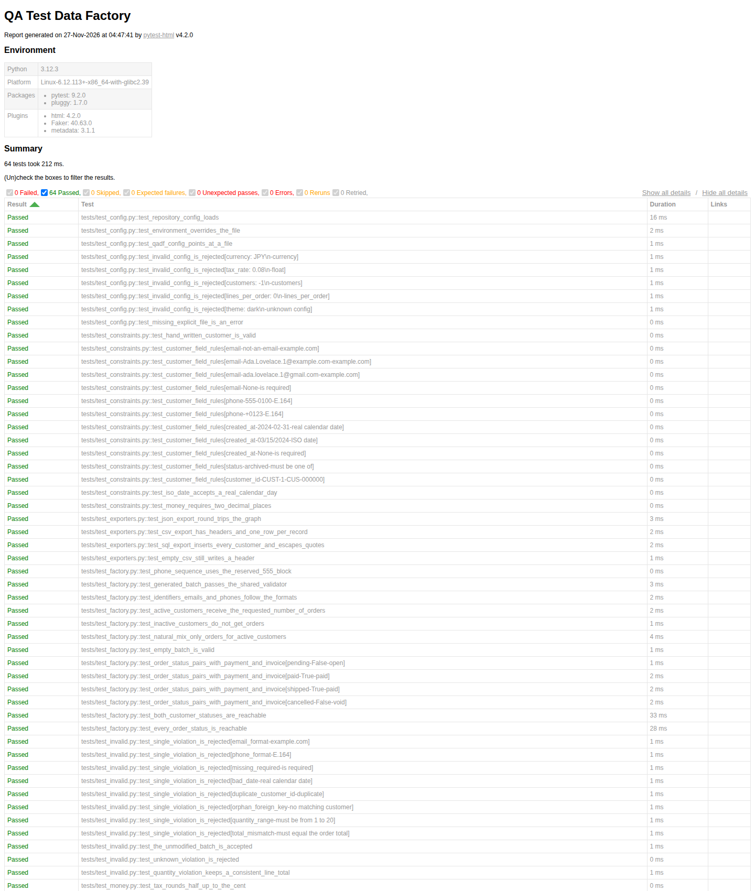

# QA Test Data Factory

A Python library that builds fictional, referentially consistent test data for QA automation: customers, orders, order lines, payments, and invoices.

[](https://github.com/Potucky/my_behave_project/actions/workflows/ci.yml)

**[Live test report](https://potucky.github.io/qa-test-data-factory/)**

This is a portfolio/demo project. It is not employer code, and it does not connect to a production system. Emails use the reserved `example.com` domain. Phone numbers use the NANP fictional range `555-0100` through `555-0199`.

The live report is published from the default branch by GitHub Actions. The URL matches the portfolio name `qa-test-data-factory`, and the repository's Pages source has to be **GitHub Actions**.

## What this project demonstrates

- Explicit data rules a suite can enforce: required fields, email and phone formats, real ISO dates, cent rounding, and quantity ranges.
- Referential integrity in one batch. Every order points at an active customer that exists, every line points at an order and a catalog SKU, and the payment and the invoice both carry the order total.
- Seeded factories, so an automated test can rebuild the same fixture and assert exact values.
- JSON, CSV, and SQL `INSERT` export, so an API test and a database fixture can load the same batch.
- Invalid records that break one rule at a time, for negative tests, and a GitHub Actions workflow that runs pytest and stores the HTML and JUnit reports.

## Tech stack

- Python 3.11+
- pytest and pytest-html
- Faker, with a seed applied to each batch
- PyYAML for factory settings
- GitHub Actions

## Project structure

```text
src/qa_data_factory/    factory, rules, invalid-data builder, exporters
tests/                  pytest suite
config/factory.yaml     default batch size, tax rate, currency, seed
examples/generate_order_graph.py
examples/sample/        JSON, CSV, and SQL from the example below
pages/index.html        page that links to the published pytest report
docs/test-report.png    screenshot of a local pytest-html run
.github/workflows/ci.yml
.github/workflows/pages.yml
```

## Rules the factory enforces

`OrderGraphFactory.build` checks these before it returns. The tests call the same `validate_graph` function.

- Customer id, name, email, phone, `created_at`, city, country, and status are required. Status is `active` or `inactive`.
- Email is lowercase and ends with `@example.com`. Phone is E.164. Generated phones are `+1` plus an area code plus `555-01xx`.
- Dates are real `YYYY-MM-DD` calendar dates. Payment timestamps are `YYYY-MM-DDTHH:MM:SSZ`.
- Ids match `CUS-000000`, `ORD-000000`, `LIN-000000`, `PAY-000000`, and `INV-000000`, and they are unique inside the batch. Invoice numbers are unique.
- Quantity is an integer from 1 to 20. Money is a two-decimal string. Line total is quantity times the catalog unit price. Tax is half-up to the cent. Total is subtotal plus tax.
- Every order belongs to an active customer in the same batch. Inactive customers have no orders. Every line uses a SKU, name, and unit price from the fixed catalog.
- `pending` has no payment and an open invoice. `paid` and `shipped` have one captured payment equal to the total and a paid invoice. `cancelled` has no payment and a void invoice. The invoice is issued on the order date and due 30 days later. The order date is on or after the customer `created_at`.

The same seed and the same counts return the same graph. `InvalidDataFactory` starts from a valid graph and breaks one of those rules.

## Example

```python
from qa_data_factory import OrderGraphFactory

graph = OrderGraphFactory(seed=42).build(
    customers=2,
    orders_per_customer=1,
    lines_per_order=2,
)
```

Danielle Johnson (`CUS-000001`) is inactive, so she has no order. Jill Rhodes (`CUS-000002`) is active. Her order is paid. The lines are `4 × 19.99 = 79.96` and `3 × 16.40 = 49.20`. Subtotal `129.16`. Tax at 8% rounds half-up from `10.3328` to `10.33`. Total `139.49`. The captured payment and the invoice both use `139.49`. The invoice is issued on `2024-01-28` and due on `2024-02-27`.

`examples/sample/order_graph.json` is that batch:

```json
{
  "seed": 42,
  "tax_rate": "0.08",
  "currency": "USD",
  "customers": [
    {
      "customer_id": "CUS-000001",
      "first_name": "Danielle",
      "last_name": "Johnson",
      "email": "danielle.johnson.1@example.com",
      "phone": "+12025550100",
      "created_at": "2024-11-23",
      "city": "Johnberg",
      "country": "United States",
      "status": "inactive"
    },
    {
      "customer_id": "CUS-000002",
      "first_name": "Jill",
      "last_name": "Rhodes",
      "email": "jill.rhodes.2@example.com",
      "phone": "+12025550101",
      "created_at": "2024-01-13",
      "city": "New Roberttown",
      "country": "United States",
      "status": "active"
    }
  ],
  "orders": [
    {
      "order_id": "ORD-000001",
      "customer_id": "CUS-000002",
      "order_date": "2024-01-28",
      "status": "paid",
      "currency": "USD",
      "subtotal": "129.16",
      "tax": "10.33",
      "total": "139.49"
    }
  ],
  "order_lines": [
    {
      "line_id": "LIN-000001",
      "order_id": "ORD-000001",
      "sku": "SKU-TEE-001",
      "product_name": "Cotton Tee",
      "quantity": 4,
      "unit_price": "19.99",
      "line_total": "79.96"
    },
    {
      "line_id": "LIN-000002",
      "order_id": "ORD-000001",
      "sku": "SKU-BTL-001",
      "product_name": "Water Bottle",
      "quantity": 3,
      "unit_price": "16.40",
      "line_total": "49.20"
    }
  ],
  "payments": [
    {
      "payment_id": "PAY-000001",
      "order_id": "ORD-000001",
      "amount": "139.49",
      "method": "card",
      "paid_at": "2024-01-28T17:27:02Z",
      "status": "captured"
    }
  ],
  "invoices": [
    {
      "invoice_id": "INV-000001",
      "order_id": "ORD-000001",
      "invoice_number": "INV-20240128-000001",
      "issued_at": "2024-01-28",
      "due_at": "2024-02-27",
      "amount": "139.49",
      "status": "paid"
    }
  ]
}
```

The same run writes `examples/sample/orders.csv`:

```text
order_id,customer_id,order_date,status,currency,subtotal,tax,total
ORD-000001,CUS-000002,2024-01-28,paid,USD,129.16,10.33,139.49
```

and `examples/sample/seed.sql`:

```sql
INSERT INTO payments (payment_id, order_id, amount, method, paid_at, status) VALUES ('PAY-000001', 'ORD-000001', '139.49', 'card', '2024-01-28T17:27:02Z', 'captured');
```

`tests/test_sample.py` rebuilds this batch from seed 42 and compares it to those files.

A negative fixture breaks one rule:

```python
from qa_data_factory import InvalidDataFactory, validate_graph

broken = InvalidDataFactory(seed=3).build("orphan_foreign_key")
validate_graph(broken)  # ConstraintError: customer_id: no matching customer
```

Other violation names: `email_format`, `phone_format`, `missing_required`, `bad_date`, `duplicate_customer_id`, `quantity_range`, `total_mismatch`.

## Configuration

`config/factory.yaml` sets the default batch. Environment variables override the file. There are no secrets.

| Variable | Overrides | Example |
| --- | --- | --- |
| `QADF_CONFIG` | path to the YAML file | `config/factory.yaml` |
| `QADF_SEED` | `seed` | `42` |
| `QADF_CUSTOMERS` | `customers` | `5` |
| `QADF_ORDERS_PER_CUSTOMER` | `orders_per_customer` | `2` |
| `QADF_LINES_PER_ORDER` | `lines_per_order` | `2` |
| `QADF_TAX_RATE` | `tax_rate` | `0.08` |
| `QADF_CURRENCY` | `currency` (`USD`, `EUR`, `GBP`) | `USD` |

Write `tax_rate` as a string in YAML. A bare float is rejected so the cents stay exact.

## How to run locally

From the repository root, with Python 3.11 or newer:

```bash
python -m venv .venv
source .venv/bin/activate
pip install -r requirements.txt
pytest
pytest --html=reports/report.html --self-contained-html --junitxml=reports/junit.xml
PYTHONPATH=src python examples/generate_order_graph.py
```

The generator reads `config/factory.yaml` and writes JSON, CSV, and SQL under `examples/output/`. That directory is gitignored. The committed sample under `examples/sample/` is the smaller batch in the example above.

```bash
QADF_SEED=7 QADF_CUSTOMERS=10 PYTHONPATH=src python examples/generate_order_graph.py
```

## Test report

Pytest HTML report from a local run of this suite:



## Test approach

- `qa_data_factory.constraints` is the spec. The factory and the tests both call `validate_graph`.
- Referential tests also walk foreign keys themselves and recompute every total with `order_totals`.
- Rounding is checked on known amounts, including `10.01` at 8% tax, which half-up rounds to `0.80` and a total of `10.81`.
- Each `build` creates its own `random.Random` and seeded Faker. The calendar starts at `2024-01-01`. Every test is deterministic: same seed, same records, on every run.
- `InvalidDataFactory` is the source of negative fixtures. A passing control batch uses the same seed with no defect injected.
- Exporters are asserted through `tmp_path`, including a quote escaped as `O'Brien` → `'O''Brien'` in SQL.
- On every pull request, and on every push to `main`, `.github/workflows/ci.yml` runs the suite and uploads `report.html` and `junit.xml` as the `test-report` artifact.
- On a push to `main`, `.github/workflows/pages.yml` runs the suite again and deploys `report.html` plus `pages/index.html` with `actions/upload-pages-artifact` and `actions/deploy-pages`.

## Author

Vasyl Popovich, QA Automation Engineer, Miami, FL. GitHub: https://github.com/Potucky
